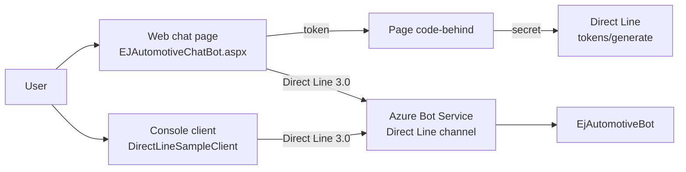

# DirectLine-Automotive

These are the client apps for an automotive chatbot demo built on Microsoft Bot Framework and Azure Bot Service. It includes two ways to talk to the bot through the Direct Line 3.0 API:

- a branded web chat page (ASP.NET Web Forms with the Bot Framework Web Chat control)
- a console client

This repository has client code only. The bot itself (`EjAutomotiveBot`) ran as a separate Azure Bot Service app. It showed car models as cards with grades, prices, features and specs. It also opened the dealer's feature pages and answered free-text questions such as "my budget is 150000 SAR, which cars suit me?". Any Bot Framework bot with a Direct Line channel works with these clients.

The code dates from February 2019 and was part of a set of chatbot demos on Azure. A stocks and mutual funds bot was in the same set.

## Repository layout

```
DirectLine-Automotive/
├── DirectLine-Automotive.sln               # Solution with both projects
├── azuredeploy.json                        # ARM template that hosts the chat page on App Service
├── DirectLineAutomotiveChatBot/            # ASP.NET Web Forms site (.NET Framework 4.6.1)
│   ├── EJAutomotiveChatBot.aspx            # The chat page (default document)
│   ├── EJAutomotiveChatBot.aspx.cs         # Swaps the Direct Line secret for a token
│   ├── Global.asax.cs                      # Turns on TLS 1.2
│   ├── Web.config                          # Empty settings, loads the secrets file
│   ├── DirectLine.secrets.config.example
│   ├── scripts/botchat.js                  # Bot Framework Web Chat
│   └── styles/                             # Web Chat styles
└── DirectLineClient/                       # Console client (.NET Framework 4.6.1)
    ├── Program.cs                          # Starts a conversation, sends input, polls for replies
    ├── App.config                          # Empty settings, loads the secrets file
    └── DirectLine.secrets.config.example
```

## How it works



### Web chat page

1. When the page loads, the code-behind calls Direct Line's `tokens/generate` endpoint with the secret from config and gets a token that's good for one conversation.
2. Only that token is written into the page, so visitors never see the secret.
3. The page starts Web Chat (`BotChat.App`) with the token. Web Chat renders text, hero and thumbnail cards, carousels and buttons, and refreshes the token while the page stays open.
4. Once the conversation is up, the page sends "hi" so the bot opens with its welcome message.

If the settings are missing or the token can't be created, the page shows a short setup message instead of a broken chat.

You can change the header colour with a query string parameter, for example `?bothighlightcolor=%23c00000`.

### Console client

1. Start a conversation with `Conversations.StartConversationAsync`.
2. Send each line you type as an `Activity` with `Conversations.PostActivityAsync`.
3. Poll `Conversations.GetActivitiesAsync` with a watermark, so each call returns only new activities, and keep the ones sent by the bot.
4. Print each reply's text. Hero and thumbnail cards are drawn as framed text blocks with their buttons. Images are listed by URL.

## Requirements

- Windows with Visual Studio 2017 or later
- .NET Framework 4.6.1
- IIS Express (the site runs at `http://localhost:62104/`)
- An Azure Bot Service bot with the Direct Line channel turned on

NuGet packages are restored on the first build:

| Package | Web | Console |
|---|---|---|
| Microsoft.Bot.Connector.DirectLine | 3.0.2 | 3.0.1 |
| Microsoft.Rest.ClientRuntime | 2.3.2 | 2.3.4 |
| Newtonsoft.Json | 6.0.8 | 9.0.1 |
| Microsoft.CodeDom.Providers.DotNetCompilerPlatform | 1.0.7 | |

## Setup

1. In the Azure portal, open your bot, add the Direct Line channel and copy one of its secret keys.
2. In `DirectLineAutomotiveChatBot`, copy `DirectLine.secrets.config.example` to `DirectLine.secrets.config` and fill in:

   ```xml
   <appSettings>
     <add key="DirectLineSecret" value="YOUR_DIRECT_LINE_SECRET" />
     <add key="BotId" value="YOUR_BOT_HANDLE" />
     <add key="BotDisplayName" value="Automotive Assistant" />
   </appSettings>
   ```

3. Do the same in `DirectLineClient` (it only needs `DirectLineSecret` and `BotId`).

`DirectLine.secrets.config` is in `.gitignore`, so your secret stays on your machine.

## Running

Open `DirectLine-Automotive.sln`.

- Web chat: set `DirectLineAutomotiveChatBot` as the startup project and press F5. The chat opens at the site root.
- Console client: set `DirectLineSampleClient` as the startup project and press F5. Type a message at `Command>`, or `exit` to quit.

## Deploying the chat page to Azure

`azuredeploy.json` creates an App Service plan and a web app, deploys this repository from GitHub, and stores `DirectLineSecret`, `BotId` and `BotDisplayName` as app settings. App settings override the empty values in `Web.config`, so no secret file is needed in Azure.

```bash
az deployment group create \
  --resource-group my-chat-rg \
  --template-file azuredeploy.json \
  --parameters directLineSecret=<secret> botId=<bot-handle>
```

The output `chatUrl` is the address of the chat page.

## Remaining limitations

- The bot isn't part of this repository, so you need an existing Bot Framework bot to talk to.
- This Web Chat version (v0.x) and Bot Framework v3 have since been retired. A current build would use Web Chat v4 with a Bot Framework SDK v4 or Copilot Studio bot.

## Credits

The console client is based on Microsoft's [Direct Line sample](https://github.com/microsoft/BotBuilder-Samples) from the Bot Builder samples repository. The chat page uses the [Bot Framework Web Chat](https://github.com/microsoft/BotFramework-WebChat) control.
