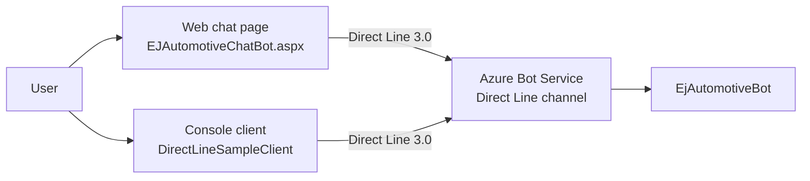

# DirectLine-Automotive

These are the client apps for an automotive chatbot demo built on Microsoft Bot Framework and Azure Bot Service. It includes two ways to talk to the bot through the Direct Line 3.0 API:

- a branded web chat page built with ASP.NET, Bootstrap and AngularJS
- a console client

This repository has client code only. The bot itself (`EjAutomotiveBot`) ran as a separate Azure Bot Service app. It showed car models as cards with grades, prices, features and specs. It also opened the dealer's feature pages and answered free-text questions such as "my budget is 150000 SAR, which cars suit me?".

The code dates from February 2019 and was part of a set of chatbot demos on Azure. A stocks and mutual funds bot was in the same set.

## Repository layout

The source is stored as a single archive, `DirectLine-Automotive.zip`. Unzip it to get this structure:

```
DirectLine-Automotive/
├── azuredeploy.json                      # ARM template for an App Service (from the Bot Builder samples)
├── DirectLineBot.sln                     # Solution for the console client
├── DirectLineClient/                     # Console client (.NET Framework 4.6.1)
│   ├── Program.cs                        # Starts a conversation, sends input, polls for replies
│   ├── Models/DirectLineCardContent.cs
│   ├── App.config                        # DirectLineSecret and BotId
│   └── packages.config
└── DirectLineAutomotiveChatBot/
    └── DirectLineAutomotiveChatBot/
        ├── DirectLineAutomotiveChatBot.sln
        └── DirectLineAutomotiveChatBot/  # ASP.NET Web Forms site (.NET Framework 4.6.1)
            ├── EJAutomotiveChatBot.aspx  # The chat page
            ├── EJAutomotiveChatBot.aspx.cs
            ├── Web.config                # DirectLineSecret and BotId
            ├── scripts/                  # jQuery, Bootstrap, AngularJS, chat.js (ChatLib), botchat.js, marked
            └── styles/                   # Bootstrap themes, botchat and chat styles
```

## How it works



The two clients use the same Direct Line pattern:

1. Start a conversation with `Conversations.StartConversationAsync`.
2. Send each user message as an `Activity` with `Conversations.PostActivityAsync`.
3. Poll `Conversations.GetActivitiesAsync` with a watermark, so each call returns only new activities. Keep the ones sent by the bot.
4. Show each reply's text and its attachments. Hero cards are drawn as a framed text block in the console, and image attachments are listed by URL.

The web page does this in the browser. `ChatLib.ChatClient` (in `scripts/chat.js`) takes the bot ID and a Direct Line secret or token. AngularJS binds the message list (`GetMessages`) and the send button (`sendTextMessage`). Replies are rendered as Markdown through `marked`, with sanitising turned on. You can override the header colour with a `bothighlightcolor` query string parameter.

The page's code-behind (`EJAutomotiveChatBot.aspx.cs`) has a server-side copy of the console logic. It is commented out of `Page_Load`, so all chat traffic goes from the browser.

## Requirements

- Windows with Visual Studio 2017 or later
- .NET Framework 4.6.1
- IIS Express (the site runs at `http://localhost:62104/`)
- An Azure Bot Service bot with the Direct Line channel turned on

NuGet packages (restored on build):

| Package | Version |
|---|---|
| Microsoft.Bot.Connector.DirectLine | 3.0.1 (console), 3.0.2 (web) |
| Microsoft.Rest.ClientRuntime | 2.3.2 / 2.3.4 |
| Newtonsoft.Json | 6.0.8 / 9.0.1 |
| Microsoft.CodeDom.Providers.DotNetCompilerPlatform | 1.0.7 |

## Setup

1. Unzip `DirectLine-Automotive.zip`.
2. In the Azure portal, open your bot, add the Direct Line channel and copy one of its secret keys.
3. Put the secret and the bot's handle into the config files:

   ```xml
   <appSettings>
     <add key="DirectLineSecret" value="YOUR_DIRECT_LINE_SECRET" />
     <add key="BotId" value="YOUR_BOT_HANDLE" />
   </appSettings>
   ```

   Do this in both `DirectLineClient/App.config` and the web project's `Web.config`.

4. In `EJAutomotiveChatBot.aspx`, set `botid` and `tokenOrSecret` in the inline script.

## Running

To run the console client, open `DirectLineBot.sln`, set `DirectLineSampleClient` as the startup project and press F5. Type a message at `Command>`. Type `exit` to quit.

To run the web chat, open `DirectLineAutomotiveChatBot.sln`, run the site, then go to `/EJAutomotiveChatBot.aspx`. The welcome message asks you to say "hi" to start.

## Known issues and next steps

- The page loads `/scripts/app.js`, which holds the AngularJS `ChatCtrl` controller. That file isn't in the archive, so the web page won't work until it's restored.
- The `README` linked from `DirectLineBot.sln` and the `DirectLineBot` project described in Microsoft's original sample aren't in the archive either. Only the console client is.
- The web page puts the Direct Line secret in client-side JavaScript, where any visitor can read it. For anything public, keep the secret on the server and give the browser a short-lived token from the `/v3/directline/tokens/generate` endpoint.
- Keeping the code in a zip means GitHub can't show diffs, search or browse it. Committing the unzipped source, with `bin/`, `obj/` and `packages/` ignored, would make the repository much easier to use.
- Bot Framework v3 and its Web Chat control have since been retired. A current build would use Bot Framework SDK v4 or Copilot Studio, with Web Chat v4.

## Credits

The console client and `azuredeploy.json` are based on Microsoft's [Direct Line sample](https://github.com/microsoft/BotBuilder-Samples) from the Bot Builder samples repository.
